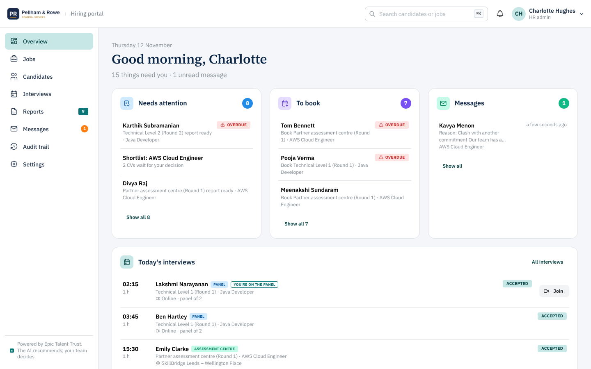

# ETT HR portal

The hiring portal for Epic Talent Trust (ETT). Each client company that buys it sees its own logo and its
own data. Client HR teams use it to:

- **see where every candidate is**: a Location column taken from the CV, asked by the AI interviewer when the
  CV has none, or set by HR (town, city or PIN code)
- **book partner assessment centres in the candidate's nearest city**: only that city's centres are offered,
  whatever dates they have free, and they take turns; other cities are an exception that needs a reason
- **set up each job their way**: paste or upload the job description (skills are suggested from it), choose
  must-have, nice-to-have and certification skills, and build the interview plan: up to 8 rounds in any
  order, each an **AI interview**, a **partner assessor** round at a partner centre, or a **panel interview**
  (online or in person), with its own name (for example "Technical Level 1"), length in hours and minutes,
  and a target time for the decision
- **turn AI shortlisting on or off per job**. When it is on, every CV is read, cleaned of Aadhaar/PAN numbers
  and scored, with red flags and India key facts (notice period, CTC, locations). When it is off, candidates
  go straight to Round 1
- **review a report after every round and decide**: progress, hold or not progressing. Panel members send a
  detailed review (a score for each of the job's skills, general measures such as communication, written
  notes and a recommendation), and the portal combines them into one panel report
- **run panel interviews without accounts for every interviewer**. HR types in each interview's panel
  (employee ID, name and email). Each member is emailed an interview code; they sign in with the shared
  panel login, enter their employee ID and the code, and see only that one interview's review form. Many
  interviews can run at the same time, because each has its own code
- **give candidates their own page** (a private link in every email) where they accept the interview time,
  ask for a new time with the days they're free, and message HR
- **hand over while on leave**: choose a colleague and the dates; they see all your jobs, candidates and
  interviews and get your notifications until you're back
- **see who changed what**: an audit trail of every change to jobs, candidates and interviews, and
  "created by" and "last updated by" on every list and page
- put jobs **on hold** (reminder emails pause; booked interviews go ahead), **close** them (upcoming
  interviews are cancelled and candidates told automatically) or reopen them, with a reason
- **clone a job** from its page, **star** the jobs that matter to you (stars are personal), and add CVs one
  at a time ("Add candidate CV") or many at once ("Upload multiple CVs")
- pick a **ready-made reason** when a candidate isn't progressing, and **undo a decision** for 5 minutes (the
  candidate's email waits until then)
- mark a **no-show and offer a new time** in one step (the new invitation says they missed the last one)
- work from an **Overview** that lists only what needs doing: what needs attention, interviews to book, the
  newest candidate messages, and today's interviews with a **Join** button for the ones you're on the panel of

The AI only recommends. People make every decision, and the portal records who made each one.



| Screen | What it shows |
| --- | --- |
| [Sign-in](docs/screenshots/01-sign-in.png) | The client's own logo on the sign-in page |
| [Overview](docs/screenshots/02-overview.png) | Needs attention, to book, messages, and today's interviews with a Join button |
| [Jobs](docs/screenshots/03-jobs.png) | Open, on hold, closed, draft and starred jobs, candidates per round, who changed each job |
| [Interview rounds](docs/screenshots/04-job-rounds.png) | Building a job's rounds: type, name, length and target time |
| [Skills](docs/screenshots/05-job-skills.png) | AI shortlisting switch and skills suggested from the job description |
| [Job](docs/screenshots/06-job-pipeline.png) | A job's rounds, overdue counts and every candidate by round |
| [Candidate](docs/screenshots/07-candidate.png) | Next step, every round's report and the decision |
| [Panel](docs/screenshots/08-candidate-panel.png) | A panel interview with its members, their reviews and the interview code |
| [Panel review](docs/screenshots/09-panel-review.png) | What a panel member sees after entering their employee ID and code |
| [Candidate's page](docs/screenshots/10-candidate-page-phone.png) | The candidate accepts, asks for a new time or messages HR, on a phone |
| [Interviews](docs/screenshots/11-interviews.png) | Ready to book, upcoming, requests for a new time, past |
| [Candidates](docs/screenshots/12-candidates.png) | Every candidate's location, round, due date and next step |
| [Reports](docs/screenshots/13-reports.png) | Round reports waiting for a decision |
| [Audit trail](docs/screenshots/14-audit-trail.png) | Who changed what, and when |
| [Leave cover](docs/screenshots/15-going-on-leave.png) | Handing work to a colleague for a period |
| [Settings](docs/screenshots/16-settings-rounds.png) | Default rounds and review measures, editable by HR admins |
| [Email wording](docs/screenshots/17-settings-emails.png) | Each email the portal sends, with a preview |
| [Team and logins](docs/screenshots/18-team-logins.png) | Who can sign in, with which role |
| [Partner assessment centre booking](docs/screenshots/19-book-partner-centre.png) | Only the nearest city's centres, taking turns, with the candidate's location and where it came from |
| [Missing information](docs/screenshots/20-missing-information.png) | CVs missing a name, email or phone, and red flags to check, inside AI shortlisting |
| [Closing a job](docs/screenshots/21-close-job.png) | What closing will do: interviews cancelled and candidates emailed |
| [Undo a decision](docs/screenshots/22-undo-decision.png) | A ready-made reason, then 5 minutes to undo before the email goes |

## Technology

| Layer | Stack |
| --- | --- |
| API | Java 25 (LTS), Spring Boot 4.1 (Spring Framework 7, Spring Security 7, Spring Data JPA, Hibernate 7) |
| Database | PostgreSQL 18, migrations with Flyway |
| CV reading | Apache Tika 4 (PDF and Word) |
| Email | Spring Mail with Thymeleaf templates |
| API docs | springdoc OpenAPI 3 (Swagger UI) |
| Web app | React 19, TypeScript 7, Vite 8, Mantine 9, TanStack Query 5, React Router 8 |
| Delivery | Docker images (Temurin 25 JRE, unprivileged nginx 1.30) and Docker Compose |

Every component is open source under a licence that allows commercial use. See
[THIRD_PARTY_NOTICES.md](THIRD_PARTY_NOTICES.md).

## Quick start with Docker

Step-by-step instructions for non-developers are in [RUN-WITH-DOCKER.txt](RUN-WITH-DOCKER.txt).

Needs Docker with Compose v2, and Git to download the code.

**1. Download the code** (once):

```bash
git clone https://github.com/epictaasforce/epictalenttrust.git
cd epictalenttrust
```

**2. Create your settings file** (once). Your settings and passwords live in a file called `.env`. It is never
stored on GitHub, so that passwords don't leak; `.env.example` is the template to copy:

```bash
cp .env.example .env          # Windows PowerShell: copy .env.example .env
```

Open `.env` in a text editor (Notepad is fine) and change `DATABASE_PASSWORD` to a long password of your own.
Everything else can stay as it is for a trial. If you skip this step, Docker stops with
"Set DATABASE_PASSWORD in .env".

**3. Start the portal:**

```bash
docker compose up -d --build
```

The first start builds the images and loads the sample data, which takes a few minutes. If it fails,
`docker compose logs backend --tail 50` shows why.

**To update later**, run `git pull`, then `docker compose up -d --build` again. Your `.env` and your data are
kept.

| What | Where |
| --- | --- |
| Portal | http://localhost:8081 |
| Test inbox (all outgoing email) | http://localhost:8025 |

With `SPRING_PROFILES_ACTIVE=demo` (the default in `.env.example`) the portal starts with a sample
client, Pellham & Rowe, with its logo, 14 partner assessment centres (three in Madurai, plus Coimbatore,
Trichy, Chennai, Bengaluru, Hyderabad, Pune, Mumbai, Kochi, London, Leeds and Manchester) and six jobs,
each with its own rounds:

| Job | Status | AI shortlisting | Rounds |
| --- | --- | --- | --- |
| AWS Cloud Engineer | Open | On | Partner assessment → Technical Level 1 → Technical Level 2 |
| Java Developer | Open | Off | Technical Level 1 → Technical Level 2 → HR round (in person) |
| Data Analyst | Open | On | AI interview → Partner assessment → HR round |
| Site Reliability Engineer | On hold | On | Panel rounds |
| Business Analyst | Closed | On | Panel rounds |
| Azure Data Engineer | Draft | On | Panel rounds |

There is a candidate at every step: shortlists to confirm, red flags, a CV that needs details, rounds
to book (some past their target time), reports to decide on, a request for a new time sent from the
candidate's page, panel reviews coming in and an offer to record. Interview reports are samples and are
labelled SAMPLE. Emma Lawson is on leave this week and Oliver Grant covers for her.

Things to try:

- **Panel review.** Sign in as `panel@pellhamrowe.example` and use employee ID **`EMP-1001`** (Demo Panel
  Member) with one of these fixed interview codes:

  | Code | Interview | What you'll see |
  | --- | --- | --- |
  | `NEHA-4825` | Neha Kulkarni, AWS Cloud Engineer, Technical Level 1 | Done; your review is still to send |
  | `MHMD-6372` | Mohammed Irfan, Java Developer, Technical Level 1 | Done; the others have sent theirs, yours is to do |
  | `FARH-5938` | Farhan Ali, AWS Cloud Engineer, Technical Level 2 | Your review is already sent; you can still change it |
  | `SNEH-2749` | Sneha Iyer, Java Developer, Technical Level 1 | Tomorrow; the code opens an hour before it starts |

  In the sample data the codes keep working for 14 days after it loads (a real installation uses 48 hours
  after the interview, set by `ETT_PANEL_REVIEW_WINDOW_HOURS`). Sign back in as HR to see the panel report.
- **Locations and the nearest centres.** The Candidates list has a Location column showing where each
  location came from. Revathi Murugan's CV gave none, so the AI interviewer asked: she's near Madurai, and
  booking her partner assessment centre round offers only the three Madurai centres. Aditya Kumar's CV has
  no location either; his shows "To ask in AI interview".
- **Candidate's page.** Every candidate email in the test inbox (http://localhost:8025) has a "your
  page" link. Divya Prakash's invitation is waiting for a reply.
- **Round robin.** Meenakshi Sundaram (Madurai) and Arun Pandian (Virudhunagar) are ready for their
  partner assessment centre round. The three Madurai centres take turns: ELCOT IT Park is next, then K K
  Nagar, then Anna Nagar. Book Meenakshi, then open Arun to see the turn move on. "Show nearest cities"
  lists other cities for exceptions; booking one asks for a reason.
- **Leave cover.** Sign in as Oliver Grant to see Emma Lawson's Java Developer job alongside his own.
- **Join link.** Charlotte Hughes is on the panel of Lakshmi Narayanan's online Technical Level 1 (Java
  Developer), about 2 hours after the sample data loads, and Oliver Grant on Ben Hartley's later the same
  day. Each sees a Join button under Today's interviews on their Overview; it lights up 15 minutes before
  the start.
- **Undo.** Decide "Not progressing" for Karthik Subramanian (pick a ready-made reason), then press Undo in
  the next 5 minutes: he goes back to where he was and the email is never sent.
- **Missing information.** AWS Cloud Engineer, AI shortlisting, Missing information: a CV without an email
  address (Add details) and a candidate with red flags to check.
- **Notice period and CTC from the AI interview.** Revathi Murugan's CV left out her expected CTC, so the AI
  interviewer asked; her key facts show it labelled "From AI interview".

The audit trail and "last updated" times of the sample data show when it was loaded, because the audit
trail is written by the database and can't be back-dated.

| Sample sign-in | Role |
| --- | --- |
| charlotte.hughes@pellhamrowe.example | HR admin: every job, Settings and the team |
| james.whitaker@pellhamrowe.example | HR admin |
| oliver.grant@pellhamrowe.example | Recruiter (owns AWS Cloud Engineer and Data Analyst; covering for Emma) |
| emma.lawson@pellhamrowe.example | Recruiter (owns Java Developer; on leave) |
| thomas.reid@pellhamrowe.example | Recruiter with no jobs yet |
| daniel.fletcher@pellhamrowe.example | Hiring manager (AWS Cloud Engineer, Data Analyst) |
| sarah.mitchell@pellhamrowe.example | Hiring manager (Java Developer) |
| panel@pellhamrowe.example | Shared panel login: opens one review with an employee ID and interview code |

All sample accounts use the password `Welcome@2026!`. On first sign-in each HR account shows a QR code
for an authenticator app (Google Authenticator, Microsoft Authenticator, 1Password and similar). The
panel login has no authenticator step: the interview code emailed to each panel member does that job.

## Clean installation

1. In `.env`, leave `SPRING_PROFILES_ACTIVE` empty.
2. Fill in `ETT_FIRST_COMPANY`, `ETT_FIRST_ADMIN_NAME`, `ETT_FIRST_ADMIN_EMAIL` and
   `ETT_FIRST_ADMIN_PASSWORD` (at least 12 characters).
3. Start the portal. On an empty database it creates that company and its admin once.
4. Remove `ETT_FIRST_ADMIN_PASSWORD` from `.env`.

## Production checklist

- Serve the portal over HTTPS only (a load balancer or reverse proxy in front of the `frontend`
  container) and set `COOKIE_SECURE=true`.
- Set `PORTAL_URL` to the public address. Links in emails use it.
- Set your own `ETT_ENCRYPTION_KEY` (see `.env.example` for how to generate one on Windows, macOS
  or Linux) and store it in a secrets manager. Without one, the portal creates a key on first start
  and keeps it with the CV files, which is fine for trials but not for production. The key encrypts the
  authenticator secrets. If it is lost, every user has to set up two-step verification again.
- Point `SMTP_*` at your mail provider and remove the `mailpit` service.
- Use a managed PostgreSQL 18 (16 or later works; for example Amazon RDS, Azure Database for PostgreSQL or Supabase)
  with automated backups, and set `DATABASE_URL`, `DATABASE_USER` and `DATABASE_PASSWORD`.
- Back up the `cv-files` volume, or mount shared storage at `/var/lib/ett/files`.
- Keep `API_DOCS_ENABLED=false`.

## Configuration

All settings are environment variables. `.env.example` lists them with explanations.

| Variable | Default | Purpose |
| --- | --- | --- |
| `DATABASE_URL` | `jdbc:postgresql://localhost:5432/ett` | PostgreSQL connection |
| `DATABASE_USER`, `DATABASE_PASSWORD` | `ett` | Database credentials |
| `ETT_ENCRYPTION_KEY` | generated on first start | 32 bytes, base64. Encrypts authenticator secrets |
| `COOKIE_SECURE` | `true` | Session cookie only over HTTPS |
| `PORTAL_URL` | `http://localhost:5173` | Public address used in email links |
| `SMTP_HOST`, `SMTP_PORT`, `SMTP_USERNAME`, `SMTP_PASSWORD`, `SMTP_AUTH`, `SMTP_STARTTLS` | no host | Outgoing email. With no host, emails are logged instead of sent |
| `ETT_MAIL_FROM` | ETT Talent Team | Sender shown on emails |
| `ETT_STORAGE_DIR` | `./data/files` | Where CV files are stored |
| `ETT_CV_RETENTION_DAYS` | `180` | CV files are deleted this many days after upload |
| `ETT_JOBS_ENABLED` | `true` | Background jobs (CV reading, alerts, reminders, digests, CV clean-up) |
| `ETT_SAMPLE_REPORTS` | `true` | Sample interview reports until the AI interviewer, assessors and panels are connected. Set `false` in a live installation |
| `ETT_SAMPLE_REPORT_DELAY_MINUTES` | `5` | Minutes after an interview ends before a sample report is added (0 = only when HR clicks) |
| `SPRING_PROFILES_ACTIVE` | none | `demo` loads sample data; `dev` relaxes settings for local development |
| `API_DOCS_ENABLED` | `false` | Serves the API docs at `/api/docs/ui` |
| `ETT_BRAND_COLOR`, `ETT_BRAND_HEADING_COLOR` | `#0a7476`, `#0b2545` | Accent and heading colours in emails |

## Client logo

Each client company has its own logo, stored in the `company_logos` table (PNG, JPG or WebP up to 1 MB;
the file type is checked from its contents and SVG is refused). An HR admin uploads it under
**Settings → Company logo**. It appears at the top of every page, and on the sign-in page when the
installation serves a single client. ETT's own mark stays small in the navigation ("Powered by Epic
Talent Trust").

## Brand colours

Every colour in the web app comes from six values in
[`frontend/src/brand.ts`](frontend/src/brand.ts): primary, accent, heading, text, muted and surface.
Hover states, light badges and borders are worked out from them, so a new palette is a change of
those values only. Then update:

- `frontend/public/favicon.svg` (browser tab icon), with the primary and accent colours
- `ETT_BRAND_COLOR` and `ETT_BRAND_HEADING_COLOR`, so emails match

## Portable edition (single computer)

A download that runs the whole portal on one Windows, macOS or Linux computer, with its own built-in
PostgreSQL. It is meant for evaluations, demos and sales trials. Teams use the Docker installation.

```bash
./packaging/build-portable.sh
# dist/ETT-HR-Portal-1.0.0-windows.zip   ETT HR Portal.exe (and a .bat fallback)
# dist/ETT-HR-Portal-1.0.0-macos.zip     Start ETT HR Portal.command (Intel and Apple silicon)
# dist/ETT-HR-Portal-1.0.0-linux.zip     start.sh
```

- The computer needs Java 25 or later. If it is missing, the launcher opens the download page.
- Double-clicking the launcher starts the database and the portal and opens the browser at
  http://localhost:8080. Sample data loads on first start; `--no-demo` starts empty.
- The portal listens on this computer only (127.0.0.1). Everything it stores, including a generated
  encryption key, stays in the `data` folder next to the launcher. Emails are written to the log
  instead of being sent.
- The launcher code is in `backend/src/portable` and is only compiled with `mvn -Pportable`, so the
  server build is unaffected. Each download's `README.txt` explains starting, signing in and
  resetting.
- `ETT HR Portal.exe` is not code-signed, so Windows SmartScreen shows a warning the first time.
  Sign it with your company's code-signing certificate before giving it to customers.

## Local development

Needs Java 25, Maven 3.9, Node.js 22.12+ (26 recommended) and PostgreSQL 18.

```bash
# Database (once)
createuser -P ett          # password: ett
createdb -O ett ett

# API on http://localhost:8080 (dev profile: local key, API docs on, sample data)
cd backend
SPRING_PROFILES_ACTIVE=dev,demo mvn spring-boot:run

# Web app on http://localhost:5173 (forwards /api to the API)
cd frontend
npm install
npm run dev
```

The `dev` profile turns off secure cookies, turns on the API docs at
http://localhost:8080/api/docs/ui and uses a fixed encryption key that must never be used anywhere else.

### Tests

```bash
cd backend
# Uses a throwaway PostgreSQL container (needs Docker) ...
mvn test
# ... or an existing empty database
TEST_DATABASE_URL=jdbc:postgresql://localhost:5432/ett_test mvn test

cd frontend
npm run lint
npm run build      # includes the TypeScript check
```

The backend suite has unit tests for the authenticator codes, encryption, CV reading, personal-data
removal, Scoring 2.0, key facts, red flags and time-slot suggestions. It also has an end-to-end API test
on real PostgreSQL that walks the whole flow: sign-in with two-step setup, job creation, CV upload and
background scoring, shortlisting, Rounds 1 to 3 with sample reports, the partner-centre booking, the
offer, notifications, company isolation, role checks, lockout and the database audit trail.

## How it works

### Repository layout

```
backend/    Spring Boot API
  src/main/java/com/epictalenttrust/hr/
    security/     Sign-in (password + authenticator code), sessions, CSRF, lockout, encryption
    company/ hruser/ staff/        Client companies, HR users, ETT staff
    job/          Jobs, skills (with live checks), job descriptions, status, and each job's round plan
    cv/           CV intake queue (background reading within 10 minutes), candidate details
    screening/    Scoring 2.0 with quoted evidence, red flags, key facts, personal-data removal
    shortlist/    HR shortlist decisions and red-flag reviews
    interview/    Booking any round (AI, partner, panel), assessor links, panels and codes, reschedules, alerts
    panel/        The shared panel login: interview codes and detailed reviews
    candidateportal/ The candidate's own page: accept, ask for a new time, message HR
    cover/        Leave cover: hand jobs, candidates and notifications to a colleague
    audit/        The audit trail page and CSV export
    report/       Reports page, round decisions and report reviews
    notification/ Notification bell, instant and daily email alerts
    settings/     Company details, default rounds, review measures, email wording, logo, cut-offs, skills
    sample/       Sample interview reports (labelled SAMPLE) until real ones are connected
    candidate/ application/        Candidates and their applications
    message/ mail/                 Candidate messages and outgoing email
    overview/ activity/            Overview and activity records
    storage/      CV file storage
    common/ config/                Errors, tenancy, audit, settings
    setup/        First admin for a clean installation
    demo/         Sample data (demo profile only)
  src/portable/java/               Portable edition launcher (built only with -Pportable)
  src/main/resources/db/migration/
    V1__ett_hr_schema.sql          The ETT HR schema (32 tables, triggers, audit trail)
    V2__portal_support.sql         Reference sequences and indexes the portal needs
    V3__sprint1_completion.sql     Logos, settings, notifications, CV intake, flags, key facts, rounds 2-3
    V4 to V6                       Team logins, centre routing, round robin
    V7, V8                         Configurable rounds, panel reviews, leave cover, candidate links, email outbox
frontend/   React web app
  src/pages/      One file per screen
  src/components/ Shared layout and display components
  src/api/        Typed API client and data hooks
  nginx/          Production web server settings and security headers
packaging/  Portable edition: build script, launchers, icon and the README.txt shipped in each download
docker-compose.yml
```

### Security

- Two-step sign-in: password, then a 6-digit authenticator code (RFC 6238). Authenticator secrets are
  encrypted with AES-256-GCM before they are stored.
- Five wrong passwords within 15 minutes lock the account for 15 minutes. Every sign-in attempt is
  written to `login_log`.
- Server-side sessions in an HTTP-only, SameSite cookie. The session ID changes at sign-in.
- CSRF protection on every change (`XSRF-TOKEN` cookie and `X-XSRF-TOKEN` header).
- Each company sees only its own data. Records from another company return "not found".
- Roles: HR admins see every job and change Settings; recruiters and hiring managers see the jobs they own
  or manage, plus any they're covering during someone's leave. Hiring managers make decisions but don't
  book interviews.
- The shared panel login can only reach the panel pages. A review opens with the member's employee ID and
  the interview's 8-character code (stored hashed for lookup, encrypted for HR to see), from an hour before
  the interview until 48 hours after it or HR's decision. Five wrong tries in 15 minutes lock the panel
  login for 15 minutes.
- The candidate's page link is a random token, stored hashed, that stops working a day after the interview.
- The partner assessor's report link is a random one-time token, stored hashed, that expires two weeks
  after the interview and stops working once the report is sent.
- Strict Content Security Policy and security headers from nginx. Containers run as non-root users.

### Audit and logs

- Every insert, update and delete is recorded by database triggers in `audit_trail`. The API tells
  PostgreSQL who is acting in each transaction, so each row names the person (or the AI agent).
- Business events go to `audit_log`. Separate logs record AI processing, CV access (who viewed or
  downloaded which CV), emails, sign-ins and errors. Every error response carries a request ID that
  matches the error log.

### AI screening (Scoring 2.0)

Screening is rule-based and explainable. It is not a black box:

- Before scoring, the CV text has the name, contact details, date of birth, gender, Aadhaar, PAN and
  passport numbers removed.
- Each criterion is judged by the strength of its evidence: used in a job in the last 3 years (full
  marks), in an older job (¾), only in a skills list (½), only mentioned (¼), or not found. Phrases such
  as "no experience in" count as not found.
- Score out of 100: must-haves 50, nice-to-haves 20, relevant experience 20, certifications 10. Sections
  a job doesn't use are left out and the rest scaled up, so there are no free points. Must-haves can
  have a minimum number of years.
- A skills dictionary understands other names ("k8s" for Kubernetes) and related evidence (EC2 counts
  towards AWS). Each client can add its own names under Settings.
- Suggestions: Shortlist (every must-have backed by work and a score at or above the client's cut-off,
  70 by default), Reserve (50+), otherwise Not recommended. Unreadable CVs go to Reserve with a reason.
- Red flags (overlapping jobs, dates that don't add up, inflated experience, keyword stuffing, hidden
  text, copied CVs, shared phone numbers) must be reviewed before shortlisting. Points to check (gaps,
  notice period, CTC over budget, location) are shown too. Flags never change the score.
- HR's decisions are compared with the suggestions under Settings → AI accuracy, to tune the cut-offs.

The engine sits behind a `ScreeningEngine` interface, so a language-model engine can replace or
complement it later without changing the rest of the portal.

### Interview rounds

Each job has its own plan of up to 8 rounds, set when the job is created (new jobs start from the company's
default plan under Settings → Interview rounds). A round is one of three types, used in any order and as
often as needed:

| Type | Who | Where | Report |
| --- | --- | --- | --- |
| AI interview | ETT AI interviewer (checks Aadhaar, PAN and the room on camera; checked by an ETT reviewer) | Online | AI interview report |
| Partner assessment centre | The centre's assessor (checks original Aadhaar and PAN, interview and hands-on task) | A partner assessment centre in the candidate's nearest centre city | Assessor report, sent through a one-time link |
| Panel interview | The client's own interviewers, typed in for each interview | Online or in person | Each member's detailed review, combined into one panel report |

Each round has a name, a length and a target time. A candidate is overdue when there's no decision that
many days after reaching the round; overdue candidates are flagged on the Overview, the Jobs list and the
Candidates list, and the owner is notified. Rounds that candidates have already reached keep their type
and place; later rounds can still change.

After each report HR decides: progress to the next round (or the offer after the last one), hold, or not
progressing. "Not progressing" offers ready-made reasons (HR admins edit the list under Settings, Decision
reasons), which HR can reword before saving. The candidate's email about a decision waits 5 minutes, so the
decision can be undone; undoing puts the candidate back and cancels the email (booking the next round sends a
waiting email straight away, so the candidate reads things in order). A panel report scores each of the job's skills and the company's general measures from 1 to
5 (overall: 60% skills, 40% measures) and combines the recommendations: a majority of hire or strong hire
suggests progressing, a majority against suggests not, a tie suggests holding. People always decide.

### Closing a job, and jobs on hold

Closing a job needs a reason. The close dialog shows what will happen first:

- every upcoming interview is cancelled: partner centre seats are released, and the panel members or the
  assessor are emailed
- each candidate with an upcoming interview gets "Interview cancelled: position closed"
- every other candidate part-way through (shortlisted, in a round or at offer) gets "Position closed".
  Candidates still being screened haven't heard from the company, so they aren't emailed

Both emails can be reworded under Settings, Email wording. Everything is recorded in each candidate's
history and the audit trail. A job on hold can't book new interviews and sends no reminder emails; interviews
already booked go ahead, and reminders start again when the job is reopened.

### Candidate location

Every candidate has a location, shown in the Location column of the Candidates list, a job's lists and the
"Ready to book" list, and on the candidate's page with their nearest partner assessment centre city.

| Source | When |
| --- | --- |
| From CV | When the CV is read: the "Current location" line first, then the address at the top, then the first preferred location |
| From AI interview | When the CV has none, the AI interviewer asks for the candidate's current city and PIN code; the report fills it in |
| Set by HR | HR types a town, city or PIN code (on the candidate's page or while booking). A place that can't be found is refused |

Locations are placed on the map offline (nothing is sent to an outside service): a PIN code first, then one of
about 110 known cities and their other names ("Bangalore", "Trichy"), then any Indian post office town or district
(`resources/geo/in-pincodes.csv`, about 18,700 PIN codes). Every change is in the audit trail. Candidates added
before this release get their location from their CV when the portal starts.

### Partner assessment centre routing

When HR books a partner assessment centre round (code in `backend/.../routing/`):

1. **The nearest centre city.** The candidate's location is compared with every centre by the haversine
   formula, then an estimate of road distance (× 1.3) and journey time. The city with the closest centre is the
   candidate's centre city: Madurai for someone in Sivakasi, Virudhunagar or Theni.
2. **Only that city's centres, whatever the date.** HR sees just those centres, with every free slot that has a
   free assessor over the next two months. A later date in the nearest city is preferred to a long journey.
3. **Taking turns (round robin).** The centres in that city share candidates. Every booking gives its centre the
   next turn number (`partner_centres.last_turn`); the centre that has gone longest without a candidate is
   marked "Next in turn" and suggested. A centre with no free slot sits out that turn and keeps its place. If HR
   books a different centre, the one that was next stays first in line. With three Madurai centres, candidates
   go to each in turn.
4. **Exceptions.** "Show nearest cities" lists the other cities, nearest first. Booking a centre outside the
   nearest city needs a short reason, which is kept on the interview and in the audit trail.
5. **No location yet.** HR is asked to add the candidate's town or PIN code before the centres are shown.

The journey estimate sits behind a `TravelEstimator` interface. A road-routing engine (for example OSRM or
OpenRouteService on OpenStreetMap data, or a commercial maps API) can replace it for exact drive times
without changing the rest of the portal. Booking a seat is atomic (`booked < seats` in one update), and an
assessor can't be double-booked.

### Background jobs

| Job | When | What |
| --- | --- | --- |
| CV intake | Every 10 seconds, and straight after an upload | Reads and scores queued CVs; tells HR when a batch is done or a CV takes longer than 10 minutes |
| Interview alerts | Every 15 minutes | Tells HR when a candidate misses the reply deadline or a round passes its target time, and reminds panel members a day after the interview if their review isn't in |
| Email retries | Every minute | Sends decision emails once their 5-minute undo time is up; tries failed emails again after 2, 10 and 30 minutes, then tells HR the email couldn't be sent |
| Leave cover | Every hour | Tells the person covering when cover starts |
| Interview reminders | Every 15 minutes | Reminds candidates who haven't replied once their reply deadline is less than a day away (paused while the job is on hold) |
| Sample reports | Every minute (when on) | Adds a sample report for interviews that have ended |
| Daily email digest | 08:13 IST | One email with the day's notifications, for people who chose daily alerts |
| CV retention | 02:30 UTC daily | Deletes CV files past their retention date and logs each deletion |

### API

The web app uses a JSON API under `/api`. With `API_DOCS_ENABLED=true`, the full reference is at
`/api/docs/ui` and the OpenAPI document at `/api/docs`.

## Licence

Proprietary. See [LICENSE](LICENSE). Third-party components keep their own licences, listed in
[THIRD_PARTY_NOTICES.md](THIRD_PARTY_NOTICES.md).
